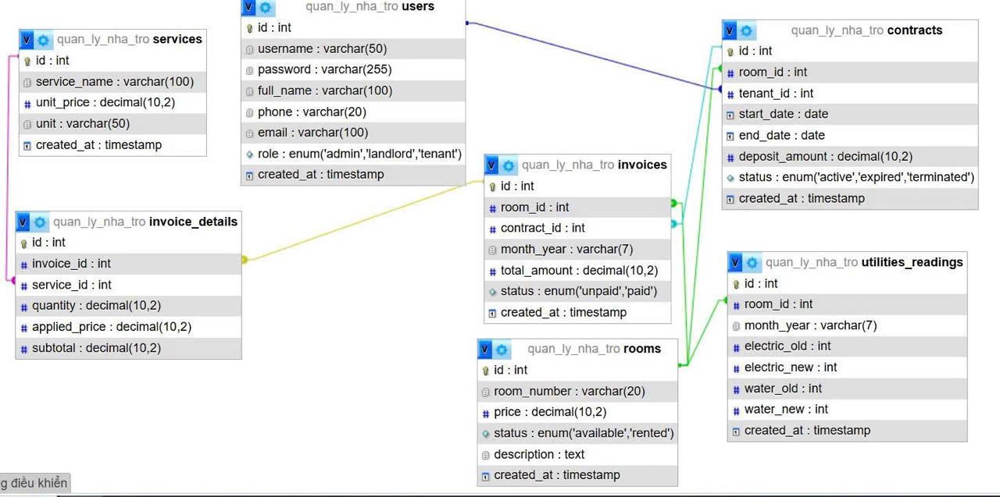

# Nhom1-BaiTapLonWeb
## CHỦ ĐỀ 10: HỆ THỐNG QUẢN LÝ NHÀ TRỌ VÀ HÓA ĐƠN ĐIỆN NƯỚC

| STT | Họ tên sinh viên | MSSV | Vai trò |
| :-: | :--- | :--- | :--- |
| 1 | Nguyễn Kim Huệ | 224001720 | Thành viên 1 |
| 2 | Nguyễn Ánh Ngọc | 224001739 | Thành viên 2 |
| 3 | Hủng Văn Ngọc | 224001738 | Nhóm trưởng – Thành viên 3 |
| 4 | Dương Thị Trang | 224001754 | Thành viên 4 |
| 5 | Đỗ Minh Nguyệt | 224001740 | Thành viên 5 |

---

## 0. Cấu trúc thư mục

```
Nhom1-BaiTapLonWeb/
├── index.php              # Hệ thống QUẢN LÝ nhà trọ – Router (index.php?route=...)
├── app/
│   ├── Config/            # Database.php – cấu hình kết nối PDO
│   ├── Controllers/       # Auth, Dashboard, Room, Contract, Utility, Invoice, Payment
│   ├── Models/            # Room, Contract, Utility, Invoice, Payment, Report
│   └── views/             # auth, dashboard, rooms, contracts, tenants, utilities
├── public/js/             # JavaScript phía client
├── database/
│   ├── schema.sql         # Tạo CSDL + 7 bảng
│   ├── seed.sql           # Dữ liệu mẫu
│   └── ERD.jpg            # Sơ đồ ERD
├── TrangXemPhong/         # (dự kiến) Trang web riêng cho khách xem phòng – tách biệt hệ thống quản lý
└── BaiTapCaNhan/          # Bài tập cá nhân của từng thành viên (tách riêng, không ảnh hưởng bài nhóm)
```

> Xem chi tiết bài tập cá nhân tại [BaiTapCaNhan/README.md](BaiTapCaNhan/README.md).

---

## BÁO CÁO BÀI TẬP NHÓM

### 1. Phân công thành viên
- **Hủng Ngọc (Nhóm trưởng – Thành viên 3)**:
  - Xây dựng trang **Quản lý Hợp đồng** (thêm / sửa / xóa hợp đồng – `ContractController`, `ContractModel`, `views/contracts`).
  - Xây dựng **Trang web xem phòng cho khách** *(đang phát triển)*: là **trang web riêng**, tách biệt với hệ thống quản lý (không phải trang Quản lý phòng `route=rooms`). Khách chưa thuê có thể vào xem tham khảo các phòng mà không cần đăng nhập.
- **Kim Huệ (Thành viên 1)**: Thiết kế giao diện Master Layout, hoàn thiện wireframe trang chủ Dashboard và form Báo cáo.
  - Đăng nhập / Đăng xuất hệ thống (`AuthController`, `views/auth/login.php`): CSRF token, validation phía server, bảo mật bằng PDO Prepared Statement.
  - Quản lý giao diện và danh sách Tòa nhà.
  - Trang Tổng quan (thống kê tỷ lệ lấp đầy phòng, doanh thu thực thu, công nợ và hợp đồng trực tiếp từ CSDL).
- **Ánh Ngọc (Thành viên 2)**: Vẽ wireframe và xây dựng giao diện (UI) cho các form Quản lý phòng, Người thuê và Hợp đồng.
- **Dương Trang (Thành viên 4)**: Cập nhật quy tắc và backend cho form ghi Chỉ số Điện/Nước và Lập Hóa đơn.
- **Minh Nguyệt (Thành viên 5)**: Rà soát tổng thể các quy tắc validation, cấu trúc Database và kiểm thử các form chính.

### 2. Danh sách Route
Mọi request đi qua `index.php` với tham số `route`:

| Route | Phương thức | Chức năng |
| :--- | :--- | :--- |
| `index.php?route=auth/login` | GET | Hiển thị form đăng nhập |
| `index.php?route=auth/process` | POST | Xử lý đăng nhập |
| `index.php?route=auth/logout` | GET | Đăng xuất, hủy session |
| `index.php?route=dashboard` | GET | Trang quản lý Tòa nhà (mặc định) |
| `index.php?route=overview` | GET | Trang Tổng quan hệ thống |
| `index.php?route=rooms` | GET / POST | Danh sách phòng / Thêm – Sửa – Xóa phòng |
| `index.php?route=contracts` | GET | Danh sách hợp đồng |
| `index.php?route=contracts/store` | POST | Thêm hợp đồng |
| `index.php?route=contracts/edit` · `contracts/update` | GET · POST | Sửa hợp đồng |
| `index.php?route=contracts/delete` | POST | Xóa hợp đồng |
| `index.php?route=utilities` | GET / POST | Nhập chỉ số điện nước *(đang phát triển)* |
| `index.php?route=invoices` | GET / POST | Lập hóa đơn & thu tiền *(đang phát triển)* |
| `index.php?route=tenants`, `reports` | GET | Khách thuê, Báo cáo *(đang phát triển)* |

### 3. Quy tắc Validation (phía Server) và Nghiệp vụ
Tất cả các form đều có input ẩn `csrf_token` và kiểm tra `hash_equals()` tại server để chống tấn công CSRF. Mọi chuỗi in ra View đều dùng `htmlspecialchars()` chống XSS.

**a. Form Đăng nhập**
- `username`: Bắt buộc, không rỗng, độ dài 3–50 ký tự. Giữ lại giá trị khi nhập sai mật khẩu.
- `password`: Bắt buộc, không rỗng.

**b. Form Thêm Hợp đồng**
- `start_date`, `end_date`: Phải đúng định dạng ngày.
- **Nghiệp vụ:** `start_date` phải trước `end_date`. Không được tạo hợp đồng có thời gian chồng lấn với hợp đồng đang hiệu lực của phòng đó.

**c. Form Ghi Điện/Nước**
- `elec_new`, `water_new`: Bắt buộc là số nguyên >= 0.
- **Nghiệp vụ:** Chỉ số mới không được nhỏ hơn chỉ số của kỳ trước. Không nhập trùng kỳ.

### 4. Mô tả Cơ sở dữ liệu
Hệ thống sử dụng CSDL MySQL, được chuẩn hóa thành 7 bảng với **Engine InnoDB** để hỗ trợ khóa ngoại và đảm bảo tính toàn vẹn tham chiếu. Các ràng buộc `UNIQUE` được áp dụng chặt chẽ để chống trùng lặp dữ liệu:

* **users**: Quản lý tài khoản đăng nhập và phân quyền 3 vai trò (admin, landlord, tenant). Có ràng buộc `UNIQUE` trên `username` và `email`.
* **rooms**: Quản lý danh sách và trạng thái phòng (available/rented). Có ràng buộc `UNIQUE` trên `room_number`.
* **services**: Cấu hình các danh mục dịch vụ phát sinh (Điện, Nước, Rác, Internet...) và đơn giá.
* **contracts**: Quản lý hợp đồng thuê phòng, liên kết khách thuê với phòng.
* **utilities_readings**: Lưu lịch sử chỉ số điện nước. Khóa phức hợp `UNIQUE(room_id, month_year)` đảm bảo mỗi phòng chỉ có tối đa một bộ chỉ số trong một tháng.
* **invoices**: Lưu tổng quát hóa đơn theo kỳ và trạng thái thanh toán. Khóa `UNIQUE(room_id, month_year)` giúp ngăn chặn lập trùng hóa đơn.
* **invoice_details**: Bảng lưu chi tiết hóa đơn (tiền phòng, điện, nước). Lưu cứng đơn giá tại thời điểm lập (`applied_price`), giúp tổng tiền hóa đơn cũ không bị thay đổi nếu admin cập nhật bảng giá dịch vụ sau này.

### 5. Sơ đồ ERD
*(Sơ đồ quan hệ thực thể của cơ sở dữ liệu)*



### 6. Hướng dẫn cài đặt Database
Thực hiện các bước sau trên **phpMyAdmin** để khởi tạo cơ sở dữ liệu và nạp dữ liệu mẫu:

1. Mở phpMyAdmin (ví dụ: `http://localhost/phpmyadmin`). Không cần tạo database thủ công.
2. Mở tab **Import (Nhập)** ở thanh menu phía trên.
3. Nhấn **Choose File (Chọn tệp)**, trỏ tới file `database/schema.sql` trong thư mục dự án.
4. Kéo xuống dưới cùng nhấn **Go (Thực hiện)**. Script sẽ tự động tạo database `quan_ly_nha_tro` và khởi tạo cấu trúc 7 bảng.
5. Lặp lại thao tác: vào tab **Import (Nhập)**, tải lên file `database/seed.sql` và nhấn **Go**. Script sẽ nạp dữ liệu mẫu (tài khoản, phòng, hợp đồng, hóa đơn) để sẵn sàng test hệ thống.
6. Cấu hình kết nối PDO trong `app/Config/Database.php` (nếu cần):
   - Database name: `quan_ly_nha_tro`
   - Encoding: `utf8mb4`

### 7. Quy trình push code (GitHub Desktop – nhánh `main`)
Cả nhóm cùng push lên nhánh `main`, nên để tránh xung đột (conflict):
1. **Trước khi code:** bấm **Fetch origin** → **Pull origin** để lấy code mới nhất.
2. Chỉ sửa các file thuộc phần mình phụ trách. Bài cá nhân để trong `BaiTapCaNhan/<tên mình>/`.
3. **Trước khi commit:** Pull thêm một lần nữa, rồi mới Commit to main → **Push origin**.
4. Nếu báo conflict, mở file bị xung đột, giữ lại phần đúng, rồi mới commit. Không xóa code của người khác.
